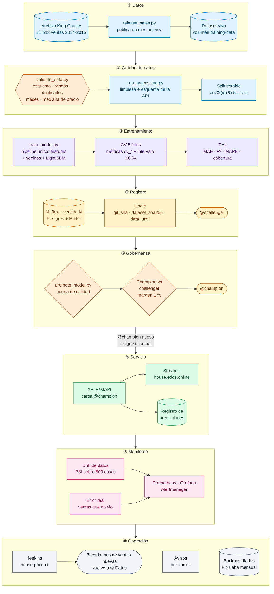
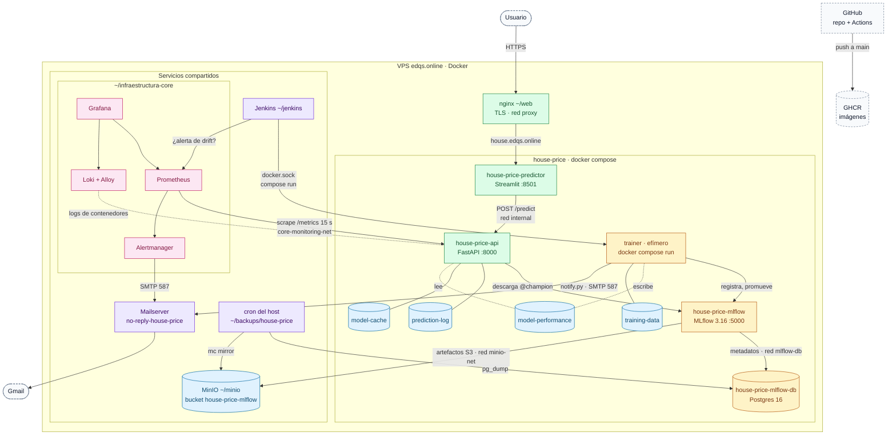
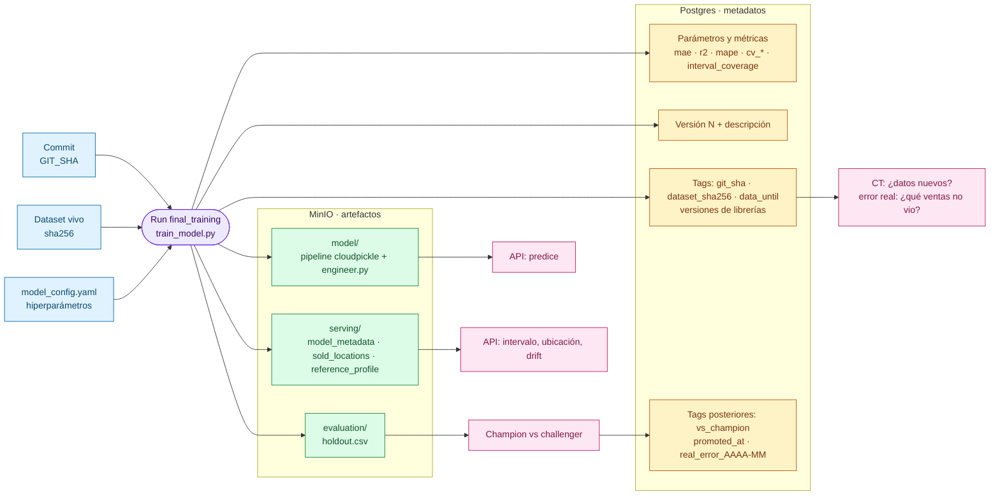
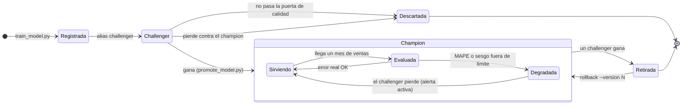
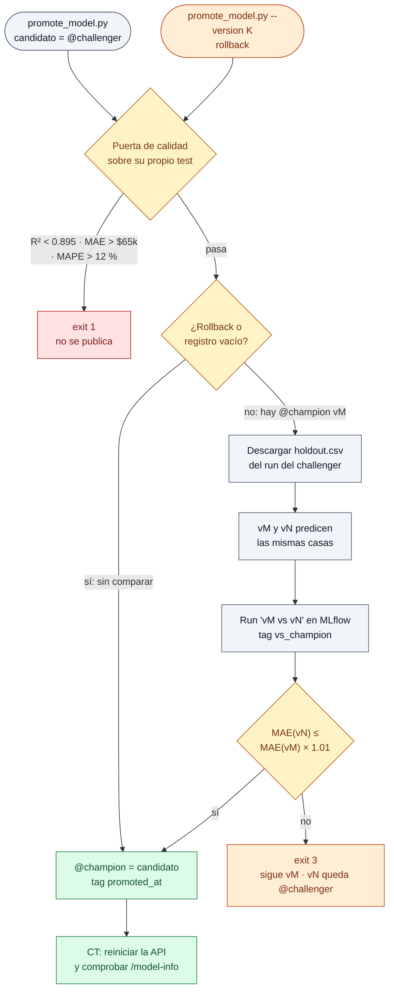
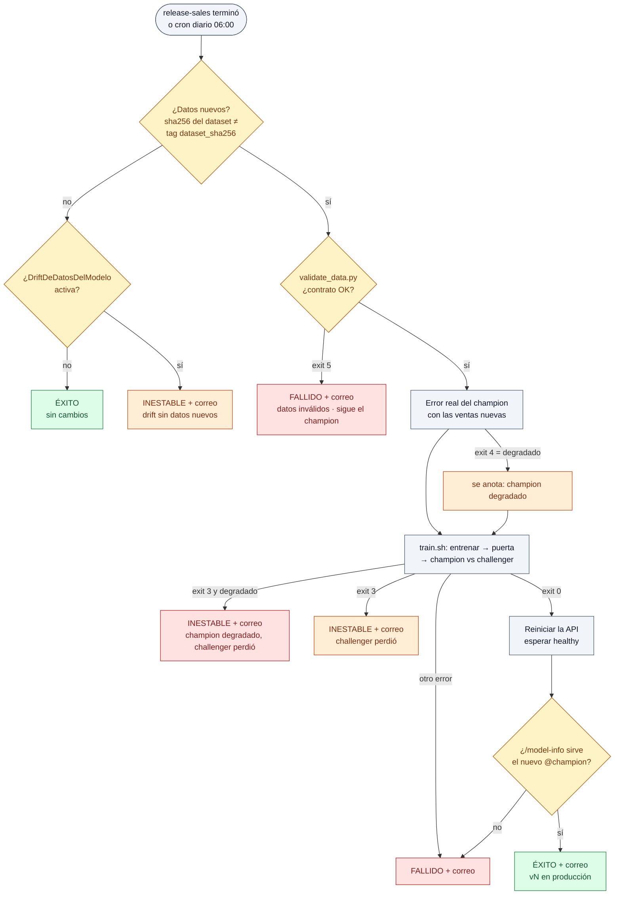
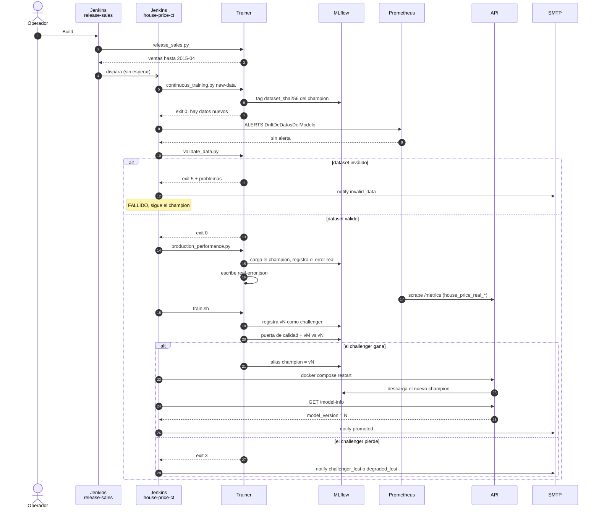
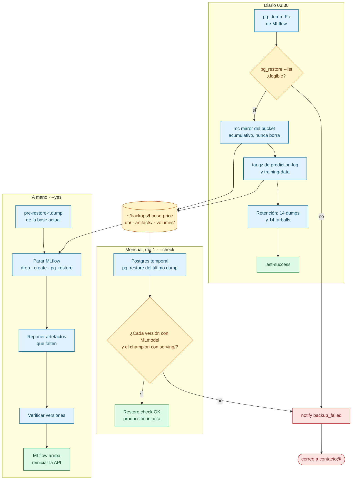
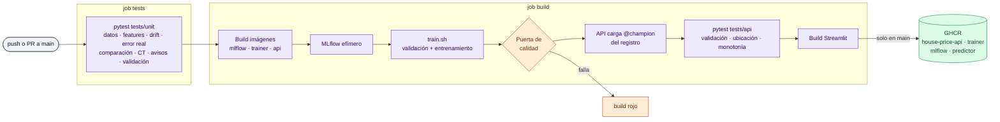
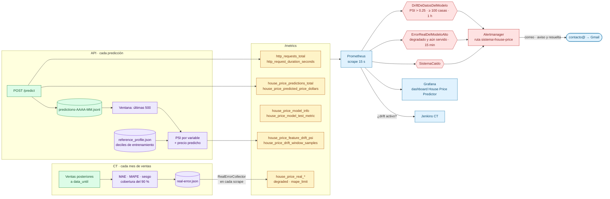

# MLOps del House Price Predictor

Este documento explica el ciclo de vida completo del modelo en producción:
cómo se entrena, cómo se decide qué versión se sirve, cómo se vigila, cómo se
reentrena solo, a quién se avisa y cómo se recupera si algo se pierde. El
[README](../README.md) cubre el dataset, la selección del modelo y el
desarrollo local; aquí se explica la operación.

**Estado a 2026-10-17:** `@champion` v5 (LightGBM, ventas hasta 2015-03),
test MAE $56.9k, R² 0.917, MAPE 10.9 %.

## Índice

1. [Visión general](#1-visión-general)
2. [Arquitectura del despliegue](#2-arquitectura-del-despliegue)
3. [Datos](#3-datos)
4. [Entrenamiento y registro](#4-entrenamiento-y-registro)
5. [Promoción: puerta de calidad y champion vs challenger](#5-promoción-puerta-de-calidad-y-champion-vs-challenger)
6. [Servicio del modelo](#6-servicio-del-modelo)
7. [Monitoreo: drift de datos](#7-monitoreo-drift-de-datos)
8. [Monitoreo: error real con ventas reales](#8-monitoreo-error-real-con-ventas-reales)
9. [Entrenamiento continuo](#9-entrenamiento-continuo)
10. [Avisos](#10-avisos)
11. [Backups y restauración](#11-backups-y-restauración)
12. [CI/CD](#12-cicd)
13. [Métricas, alertas y paneles](#13-métricas-alertas-y-paneles)
14. [Operación diaria (runbook)](#14-operación-diaria-runbook)
15. [Configuración y umbrales](#15-configuración-y-umbrales)
16. [Decisiones de diseño](#16-decisiones-de-diseño)
17. [Problemas conocidos y lecciones](#17-problemas-conocidos-y-lecciones)
18. [Lo que falta](#18-lo-que-falta)

**Diagramas:**
- [ciclo de vida completo](#1-visión-general)
- [despliegue](#diagrama-de-despliegue)
- [linaje de una versión](#linaje-de-una-versión)
- [estados de una versión](#ciclo-de-vida-de-una-versión)
- [promoción](#5-promoción-puerta-de-calidad-y-champion-vs-challenger)
- [decisiones del CT](#9-entrenamiento-continuo)
- [secuencia de un build del CT](#9-entrenamiento-continuo)
- [backups](#11-backups-y-restauración)
- [CI/CD](#12-cicd)
- [observabilidad](#13-métricas-alertas-y-paneles)

---

## 1. Visión general



El ciclo, en orden:

| # | Etapa | Qué resuelve | Dónde |
|---|---|---|---|
| 1 | Registro de modelos | Cada modelo es una versión con linaje; la API sirve un alias | MLflow, `src/models/train_model.py` |
| 2 | Drift de datos | ¿Las casas que se tasan se parecen a las de entrenamiento? | `src/monitoring/drift.py`, `src/api/prediction_log.py` |
| 3 | Champion vs challenger | Un modelo nuevo solo entra si no es peor que el actual | `scripts/promote_model.py`, `scripts/compare_models.py` |
| 4 | Entrenamiento continuo | Reentrenar solo cuando hay datos nuevos | `deployment/jenkins/`, `scripts/continuous_training.py` |
| 5 | Error real | ¿El modelo acierta con precios de venta reales? | `src/monitoring/performance.py`, `scripts/production_performance.py` |
| 6 | Avisos | Enterarse sin mirar paneles | `scripts/notify.py`, Alertmanager |
| 7 | Backups | Recuperar el registro si se pierde | `deployment/backup/` |

---

## 2. Arquitectura del despliegue

Todo corre en un VPS con Docker. El despliegue está en
`~/house-price-predictor/`:

```
~/house-price-predictor/
├── docker-compose.yml   # despliegue (fuera del repo)
├── .env                 # secretos: MinIO, Postgres, SMTP (fuera del repo)
└── app/                 # este repositorio
```

### Diagrama de despliegue

Contenedores, redes, volúmenes y servicios compartidos, con lo que viaja por cada conexión.



### Servicios (`docker-compose.yml`)

| Servicio | Contenedor | Función | Redes |
|---|---|---|---|
| `house-price-api` | `house-price-api` | FastAPI: carga `@champion`, predice, expone `/metrics` | `internal`, `core-monitoring-net` |
| `house-price-predictor` | `house-price-predictor` | Interfaz Streamlit (ES/EN, mapa) | `internal`, `proxy` |
| `mlflow` | `house-price-mlflow` | Tracking y registro; proxy de artefactos hacia MinIO | `internal`, `mlflow-db`, `minio-net` |
| `mlflow-db` | `house-price-mlflow-db` | Postgres 16 con los metadatos de MLflow | `mlflow-db` |
| `trainer` (perfil `train`) | efímero | Entrena, evalúa, promueve, avisa | `internal` |

Servicios compartidos con otros proyectos del servidor:

| Servicio | Dónde | Uso en este proyecto |
|---|---|---|
| MinIO | `~/minio` (red `minio-net`) | Bucket `house-price-mlflow` con los artefactos; usuario propio limitado al bucket |
| Prometheus, Grafana, Alertmanager, Loki | `~/infraestructura-core` | Métricas, paneles, alertas y logs |
| Jenkins | `~/jenkins` (jenkins.edqs.online) | Jobs del entrenamiento continuo |
| nginx | `~/web` | Publica Streamlit en https://house.edqs.online |
| Mailserver | `~/mailserver` | Envía los avisos desde `no-reply-house-price@edqs.online` |

### Volúmenes

| Volumen | Montado en | Contenido | ¿Backup? |
|---|---|---|---|
| `mlflow-db` | Postgres | Versiones, alias, runs, métricas, tags | Sí (pg_dump diario) |
| `training-data` | trainer `/work/data/live` | Dataset vivo de la simulación | Sí |
| `prediction-log` | API `/app/data/predictions` | JSONL mensual de cada casa tasada | Sí |
| `model-performance` | trainer (rw), API (ro) | `real-error.json`: última evaluación con ventas reales | No (se regenera) |
| `model-cache` | API `/app/models/cache` | Copia de la última versión descargada | No (se regenera) |

### Imágenes (`src/api/Dockerfile`)

Un solo Dockerfile con dos destinos y las mismas dependencias:

- `--target train` → `house-price-trainer`: código de datos, features,
  entrenamiento, monitoreo y scripts. Comando por defecto: `scripts/train.sh`.
  Los scripts van **dentro** de la imagen: tras cambiarlos hay que
  reconstruirla (`docker compose build trainer`).
- destino por defecto → `house-price-api`: la API más `engineer.py` (el
  pickle referencia sus clases), `drift.py` y `performance.py`.

`deployment/mlflow/Dockerfile` → `house-price-mlflow` (MLflow 3.16.1 +
psycopg2 + boto3).

### Acceso

| Qué | Cómo |
|---|---|
| Interfaz | https://house.edqs.online |
| UI de MLflow | `ssh -L 5555:127.0.0.1:5555 <servidor>` → http://localhost:5555 |
| Grafana | `ssh -L 10043:127.0.0.1:10043 <servidor>` → http://localhost:10043, dashboard *House Price Predictor* |
| Prometheus / Alertmanager | puertos locales 10042 / 10044 (mismo túnel) |
| Jenkins | https://jenkins.edqs.online (con autenticación básica en nginx + login de Jenkins) |

La API no sale a internet: solo la ven Streamlit y Prometheus.

---

## 3. Datos

- **Fuente:** King County House Sales (Kaggle, CC0), 21.613 ventas de mayo
  2014 a mayo 2015 en `data/raw/kc_house_data.csv`.
- **Limpieza** (`src/data/run_processing.py`): de cada casa vendida dos
  veces se conserva la venta más reciente (para que una casa no quede a la
  vez en train y test) y se descartan los errores de captura (0 o más de 10
  dormitorios, 0 baños). Se mapea al esquema de la API (`sqft`, `lat`,
  `long`, `condition` como texto…) y se calcula `sale_month` (1 = enero
  2014).
- **Validación** (`src/data/validate_data.py`), antes de todo lo demás: ver
  [Validación del dataset](#validación-del-dataset).
- **Split estable** (`is_test_house` en `train_model.py`): una casa es de
  test si `crc32(id) % 5 == 0` (≈20 %). Con un split aleatorio, al crecer el
  dataset las casas cambiarían de lado y una versión entrenaría con el test
  de otra; así ninguna versión ve jamás una casa de test y la comparación
  champion vs challenger es limpia.

### Validación del dataset

Un modelo entrenado con datos rotos puede pasar la puerta de calidad, porque
su test está igual de roto. Por eso el ciclo comprueba el contrato del
dataset crudo antes de medir el error real y de entrenar (bloque
`data_validation` de `configs/model_config.yaml`):

| Comprobación | Regla |
|---|---|
| Columnas | Las 14 que usan la limpieza, el modelo y la API |
| Nulos y tipos | Ningún vacío ni valor no numérico en ellas |
| Fecha | Formato `AAAAMMDDT000000` |
| Rangos | Los que acepta la API (`schemas.py`); precio $50k–$20M, superficie 200–20.000 sqft |
| Errores de captura | La limpieza no puede descartar más del 1 % de las filas (hoy 0,08 %) |
| Duplicados | Ninguna venta repetida (misma casa y fecha): un mes publicado dos veces |
| Meses | Seguidos, sin huecos, con al menos 300 ventas cada uno |
| Precio | La mediana del último mes no se aparta más de ±25 % de la de los anteriores (en 2014-2015 varió entre −9 % y +8 %): un cambio de unidades salta aquí |

Salida `5` si falla, con cada problema en la salida. `train.sh` la corre
primero; el CT la tiene como etapa propia y, si falla, termina **fallido**
sin tocar el champion y manda el aviso `invalid_data` con los problemas.

Probado con el dataset vivo con los precios de marzo en miles de dólares y 50
ventas repetidas: detecta los valores fuera de rango, las ventas duplicadas y
la mediana del mes (−100 %).

```bash
python src/data/validate_data.py --input data/live/kc_house_data.csv
```

### Simulación de datos nuevos

El dataset es fijo, así que para tener un entrenamiento continuo real se
simula la llegada de ventas: `scripts/release_sales.py` usa el archivo
completo como "mundo" y publica las ventas mes a mes en el dataset vivo
(volumen `training-data`), con el que entrena el trainer (`DATASET`).

```bash
python scripts/release_sales.py --init 2015-02   # reinicia con las ventas hasta febrero de 2015
python scripts/release_sales.py                  # publica el mes siguiente
```

El mismo corte da siempre el mismo archivo y el mismo hash: el CT sabe si
hay datos nuevos comparando hashes.

Historia de la simulación:

| Publicado hasta | Versión | Cómo llegó a champion |
|---|---|---|
| 2015-02 (inicio) | v4 | `--skip-comparison`: el champion anterior había entrenado con todo el archivo, test incluido |
| 2015-03 | v5 | CT: ganó a v4 en el mismo test ($56.9k frente a $57.2k) |
| 2015-04, 2015-05 | — | pendientes (`house-price-release-sales`) |

---

## 4. Entrenamiento y registro

`scripts/train.sh` encadena el ciclo:

```
run_processing.py → train_model.py → promote_model.py (si PROMOTE != false)
```

### `src/models/train_model.py`

1. Lee la configuración (`configs/model_config.yaml`) y los datos limpios.
2. Separa train/test con el split estable.
3. Construye **un único pipeline** de scikit-learn
   (`src/features/engineer.py`): variables (ratio dormitorios/baños, mes de
   venta, precios de las 10 ventas vecinas) → imputación y one-hot →
   LightGBM, envuelto en `TransformedTargetRegressor` sobre `log(precio)`.
   Entrenamiento e inferencia calculan las variables con el mismo código.
4. Validación cruzada de 5 folds sobre train: métricas `cv_*` y residuos
   fuera de muestra para el **intervalo del 90 %** (cuantiles 5 y 95 del
   cociente real/predicho).
5. Ajusta con todo train y evalúa en test: `mae`, `r2`, `mape`,
   `interval_coverage`.
6. Registra el modelo en MLflow como nueva versión de `house_price_model`
   con alias **`@challenger`**.

Lo que se guarda con cada versión:

| Dónde | Qué |
|---|---|
| Modelo (`models:/house_price_model/N`) | Pipeline completo, formato cloudpickle, `engineer.py` en `code_paths`, firma con las entradas de la API |
| Tags de la versión | `git_sha`, `dataset_sha256`, `data_until`, versiones de Python/sklearn/LightGBM/pandas/numpy |
| Artefactos `serving/` | `model_metadata.json` (métricas, intervalo), `sold_locations.npy` (validación de ubicación), `reference_profile.json` (perfil para el drift) |
| Artefacto `evaluation/holdout.csv` | Test de esta versión, para champion vs challenger |
| Descripción | Algoritmo, filas, fecha de corte y métricas en una línea |

### Linaje de una versión

Qué entra en cada entrenamiento, dónde queda cada cosa (Postgres o MinIO) y quién la usa después.



Más tags que se agregan después: `vs_champion` (resultado de la
comparación), `promoted_at` y `real_error_AAAA-MM` (error con ventas reales).

### Ciclo de vida de una versión

Una versión pasa por estos estados según lo que decidan la puerta de calidad, la comparación y el error real:



---

## 5. Promoción: puerta de calidad y champion vs challenger

`scripts/promote_model.py` decide si `@challenger` pasa a `@champion`:



- **Puerta de calidad** (`quality_gate`): mínimos absolutos sobre las
  métricas de test del propio challenger.
- **Champion vs challenger** (`champion_challenger`): las métricas
  registradas no son comparables entre versiones entrenadas con datos
  distintos, así que las dos versiones predicen **las mismas casas** (el
  holdout del challenger, que ninguna vio). El margen de 1 % deja promover un
  modelo con datos más recientes que empata dentro del ruido.
- Cada comparación queda como run `vN vs vM` en MLflow
  (`stage = champion_vs_challenger`) y como tag `vs_champion` del challenger.

```bash
python scripts/promote_model.py                   # @challenger, con las dos comprobaciones
python scripts/promote_model.py --version 3       # rollback explícito, sin comparar
python scripts/promote_model.py --skip-comparison # forzar aunque pierda
```

Códigos de salida: `0` promovido, `1` puerta de calidad no superada, `3`
challenger perdió (no es un error del ciclo).

---

## 6. Servicio del modelo

`src/api/inference.py` al arrancar:

1. Descarga `MODEL_URI` (`models:/house_price_model@champion`) y sus
   artefactos `serving/` del servidor MLflow.
2. Los guarda en `model-cache`: si MLflow no responde, sirve la última copia
   en vez de caerse.
3. Carga el perfil de drift del modelo servido.

Endpoints:

| Endpoint | Qué hace |
|---|---|
| `POST /predict` | Precio, intervalo del 90 %, importancia de variables, latencia |
| `POST /batch-predict` | Lista de precios |
| `GET /model-info` | Metadatos del modelo servido, categorías válidas, área del mapa |
| `GET /health` | Estado y versión servida |
| `GET /metrics` | Métricas HTTP y del modelo para Prometheus |

Validaciones: el esquema (`src/api/schemas.py`) limita rangos; la API rechaza
condiciones desconocidas (`unknown_condition`) y ubicaciones a más de 0,5 km
de cualquier venta (`location_too_far`: lagos, fuera del condado).

**Cambiar de versión requiere reiniciar la API** (`docker compose restart
house-price-api`); el CT lo hace solo y comprueba que sirve la versión
esperada.

---

## 7. Monitoreo: drift de datos

**Pregunta:** ¿las casas que piden tasar se parecen a las de entrenamiento?

- Al entrenar se guarda `reference_profile.json`: deciles de cada entrada
  numérica, proporciones de `condition` y distribución de las predicciones
  fuera de muestra.
- Cada casa tasada se agrega a `data/predictions/predictions-AAAA-MM.jsonl`
  (entradas, precio predicho, versión, hora).
- Sobre las últimas `DRIFT_WINDOW` (500) la API calcula el **PSI** de cada
  variable y del precio predicho, y lo expone como
  `house_price_feature_drift_psi{feature}`. Al arrancar relee la ventana del
  registro: no vuelve a cero con cada reinicio.

| PSI | Lectura |
|---|---|
| < 0.1 | estable |
| 0.1 – 0.25 | cambio moderado |
| > 0.25 | cambio importante |

Con pocas muestras el PSI no baja a 0 aunque no haya drift (≈ (bins−1)/n:
0.09 con 100 casas), por eso la alerta `DriftDeDatosDelModelo` exige PSI >
0.25 durante 1 hora **y** al menos 100 casas en la ventana.

El drift **no dice si el modelo se equivoca**: solo que le preguntan por
casas distintas. Para eso está el error real.

---

## 8. Monitoreo: error real con ventas reales

**Pregunta:** ¿el modelo acierta cuando se conoce el precio de venta?

Cuando se publica un mes de ventas, **antes de reentrenar**, el `@champion`
tasa esas casas (todas posteriores a su tag `data_until`: nunca las vio) y se
compara con el precio real. Es su error en producción, medido en el mismo
momento en que un modelo real se enfrentaría a ventas nuevas.

`scripts/production_performance.py` → `src/monitoring/performance.py`:

| Métrica | Definición |
|---|---|
| `mae`, `mape`, `r2` | Error frente al precio de venta |
| `bias` (sesgo) | Mediana de (predicho − vendido) / vendido. Negativo: tasa por debajo del mercado |
| `interval_coverage` | Ventas dentro del intervalo del 90 % que da la API (debería rondar 0.9) |

Se predice **sin `sale_month`**, como la API (que usa el último mes de
entrenamiento): se mide exactamente lo que habría respondido producción.

**Degradado** si, con al menos 200 ventas:

- MAPE real > MAPE de test × 1.15, **o**
- |sesgo| > 5 %.

Calibración con v4 (ventas hasta 2015-02, MAPE de test 10.8 %) sin
reentrenar, medida con los meses siguientes:

| Mes | MAPE | Sesgo | En el 90 % | ¿Degradado? |
|---|---|---|---|---|
| 2015-03 | 11.9 % | −3.5 % | 88.4 % | no |
| 2015-04 | 12.3 % | −5.8 % | 87.9 % | sí (sesgo) |
| 2015-05 | 13.3 % | −6.6 % | 83.0 % | sí (MAPE y sesgo) |

El sesgo negativo creciente es **concept drift**: los precios suben y un
modelo congelado se queda atrás. Es exactamente lo que el reentrenamiento
mensual corrige.

Dónde queda cada evaluación:

- **MLflow:** un run por versión y mes (`stage = production_performance`,
  tags `model_version`, `month`, `degraded`) y un tag `real_error_AAAA-MM` en
  la versión. No se duplica si se vuelve a correr.
- **`real-error.json`** en el volumen `model-performance`: la última
  evaluación. La API lo relee en cada scrape (`RealErrorCollector` en
  `src/api/metrics.py`) y lo publica como `house_price_real_*` con etiquetas
  `model_version` y `month`.
- **Alerta `ErrorRealDelModeloAlto`:** solo si la versión degradada **sigue
  siendo la que se sirve** (se cruza con `house_price_model_info`). Si el
  reentrenamiento ya la reemplazó, el problema se resolvió y no avisa.

Salida del script: `0` bien o sin ventas nuevas, `4` degradado.

---

## 9. Entrenamiento continuo

Dos jobs de Jenkins. Su lógica vive en los `.groovy` del repo
(`deployment/jenkins/`); el job solo hace `load` del archivo desde el
despliegue, que Jenkins monta en la misma ruta. Un cambio en el repo rige en
el siguiente build sin tocar Jenkins (pero si cambia un script de Python, hay
que reconstruir la imagen del trainer).

| Job | Pipeline | Disparo |
|---|---|---|
| `house-price-release-sales` | `release-sales.groovy` | A mano: publica el mes siguiente (parámetro `INIT_UNTIL` para reiniciar) y dispara el CT |
| `house-price-ct` | `continuous-training.groovy` | Al terminar el anterior y un cron diario (`H 6 * * *`) |



Un build completo con datos nuevos, paso a paso:



Detalles:

- **¿Por qué no reentrenar por drift?** Sin ventas nuevas con precio,
  reentrenar daría el mismo modelo: el drift solo avisa de que hay que
  revisar qué casas se tasan.
- **El drift se consulta a Prometheus** en cada build (no hay webhook de
  Alertmanager → Jenkins: Jenkins exige autenticación para disparar builds).
- Códigos de salida que entiende el pipeline: `scripts/continuous_training.py`
  `0` sí / `10` no; `train.sh` `3` challenger perdió;
  `production_performance.py` `4` degradado; `validate_data.py` `5` datos
  inválidos.

Resultados posibles del build:

| Resultado | Descripción del build | Significado |
|---|---|---|
| Éxito | `sin cambios` | Nada nuevo |
| Éxito | `vN en producción` | Ganó el challenger y la API lo sirve |
| Inestable | `challenger perdió` | Sigue el champion |
| Inestable | `champion degradado, challenger perdió` | Hay que intervenir |
| Inestable | `drift sin datos nuevos` | Revisar el tráfico |
| Fallido | `datos inválidos` | El dataset no cumple el contrato: no se entrenó |
| Fallido | — | Error del ciclo o puerta de calidad |

---

## 10. Avisos

Todos los correos salen del mailserver propio con
`no-reply-house-price@edqs.online` hacia `contacto@edqs.online` (que reenvía
a Gmail). Credenciales SMTP en el `.env` del despliegue (`SMTP_*`,
`NOTIFY_TO`).

### Desde el entrenamiento continuo (`scripts/notify.py`)

| Evento | Cuándo |
|---|---|
| `promoted` | Nuevo modelo en producción |
| `challenger_lost` | El challenger perdió |
| `degraded_lost` | Champion degradado y el challenger no lo supera |
| `drift_no_data` | Drift sin ventas nuevas |
| `invalid_data` | El dataset no pasó la validación (con la lista de problemas) |
| `failed` | Cualquier excepción del pipeline |
| `backup_failed` | Falló el backup o la prueba de restauración |
| `test` | Prueba de la configuración SMTP |

Cada correo incluye el estado del registro (champion, challenger, su
comparación y el último error real) consultado a MLflow con timeout corto, y
el enlace al build. Si el envío falla, el job lo anota y sigue: un aviso
perdido no tumba el ciclo.

```bash
docker compose run --rm --no-deps trainer python scripts/notify.py test
```

### Desde Alertmanager (`~/infraestructura-core/alertmanager/alertmanager.yml`)

- SMTP con la misma cuenta; contraseña en `alertmanager/secretos/smtp_password`
  (fuera de git, dueño 65534, modo 600).
- Ruta `sistema = "house-price"` → receptor `house-price-correo`, la primera
  del árbol y con `continue: true`: el correo sale y la alerta sigue su ruta
  normal.
- Plantilla `correo.institucional` (asunto, descripción, acción, enlace a
  Prometheus), con aviso también cuando se resuelve.
- Los receptores institucionales de la plataforma siguen sin destino: solo
  house-price manda correo.

---

## 11. Backups y restauración

Detalle completo en [`deployment/backup/README.md`](../deployment/backup/README.md).

| Qué | Cómo | Retención |
|---|---|---|
| Base de MLflow | `pg_dump --format=custom`, verificado con `pg_restore --list` | 14 |
| Artefactos (bucket) | `mc mirror` acumulativo: nunca borra | todo |
| `prediction-log`, `training-data` | `tar.gz` | 14 |



Destino: `~/backups/house-price/`. Primero la base y luego los artefactos:
el espejo siempre contiene lo que referencia el dump más reciente.

Programación (cron del host, independiente de Jenkins):

```cron
30 3 * * *  backup-registry.sh              # backup diario
15 4 1 * *  restore-registry.sh --check     # prueba de restauración mensual
```

- `restore-registry.sh --check`: restaura el último dump en un Postgres
  temporal y comprueba que cada versión tenga su `MLmodel` en el espejo y el
  `@champion` sus archivos `serving/`. No toca producción.
- `restore-registry.sh --yes [DUMP]`: restauración real. Guarda antes la base
  actual en `pre-restore-*.dump`, reemplaza la base, repone los artefactos
  que falten, verifica y reinicia la API.
- Los fallos de ambos avisan por correo; el último backup bueno queda en
  `~/backups/house-price/last-success` y el log en `backup.log`.

**Límite:** los backups están en el mismo disco; no protegen de perder el
servidor (ver [Lo que falta](#18-lo-que-falta)).

---

## 12. CI/CD

`.github/workflows/ci.yml`, en cada push y PR a `main`:



1. **Pruebas unitarias** (`tests/unit`): limpieza de datos, features, drift,
   error real, comparación de modelos, CT, avisos.
2. **Build** de las imágenes de MLflow, trainer y API.
3. **MLflow efímero**, entrenamiento, registro y **puerta de calidad** al
   promover (el registro empieza vacío: no hay champion contra quien
   comparar).
4. **API cargando `@champion` del registro**, como en producción, y pruebas
   de API (`tests/api`): validación, ubicaciones, que los precios se muevan
   en la dirección esperada.
5. Build de Streamlit y, en `main`, **publicación en GHCR**
   (`house-price-api`, `house-price-trainer`, `house-price-mlflow`,
   `house-price-predictor`).

Pruebas locales sin instalar nada (con la imagen del trainer):

```bash
cd ~/house-price-predictor
docker compose run --rm --no-deps -v $PWD/app:/src:ro -w /src trainer \
  sh -c 'pip install -q pytest==8.3.3 && python -m pytest -q -p no:cacheprovider tests/unit'
```

---

## 13. Métricas, alertas y paneles

De dónde sale cada métrica, qué alerta la vigila y a dónde llega:



### Métricas propias (`/metrics` de la API)

| Métrica | Tipo | Etiquetas | Qué mide |
|---|---|---|---|
| `house_price_predictions_total` | counter | `endpoint`, `outcome` | Casas tasadas y rechazos por motivo |
| `house_price_predicted_price_dollars` | histogram | — | Distribución de precios predichos |
| `house_price_model_test_metric` | gauge | `metric` | MAE/R²/MAPE de test del modelo servido |
| `house_price_model_info` | gauge | `version`, `algorithm`, `train_rows` | Versión servida |
| `house_price_feature_drift_psi` | gauge | `feature` | PSI por variable |
| `house_price_drift_window_samples` | gauge | — | Casas en la ventana del drift |
| `house_price_real_mape`, `_mae_dollars`, `_bias`, `_interval_coverage`, `_sales` | gauge | `model_version`, `month` | Error real de la última evaluación |
| `house_price_real_mape_limit`, `_max_abs_bias` | gauge | ídem | Umbrales con que se evaluó |
| `house_price_real_degraded` | gauge | ídem | 1 si quedó degradado |

Más las HTTP de `prometheus-fastapi-instrumentator` (`http_requests_total`,
`http_request_duration_seconds`). Prometheus las raspa en el job
`sistemas-backend` (`targets/sistemas.yml`, `sistema=house-price`).

### Alertas (`prometheus/rules/house-price.rules.yml`)

| Alerta | Condición | Severidad |
|---|---|---|
| `DriftDeDatosDelModelo` | PSI > 0.25 en alguna variable, ≥ 100 casas, durante 1 h | aviso |
| `ErrorRealDelModeloAlto` | `house_price_real_degraded == 1` para la versión servida, durante 15 min | aviso |

Más las genéricas de la plataforma que aplican (por ejemplo `SistemaCaido`).

### Grafana: dashboard *House Price Predictor*

| Fila | Paneles |
|---|---|
| (cabecera) | Estado, predicciones y rechazos 24 h, latencia p95, R²/MAE/MAPE de test |
| Tráfico de la API | Peticiones por endpoint y código, latencia de `/predict` |
| Modelo | Predicciones por resultado, precio predicho (mediana, p90), distribución |
| Drift de datos | Casas en la ventana, PSI por variable (ahora y en el tiempo) |
| Error real | Estado del champion, MAPE/MAE real, sesgo, cobertura, ventas evaluadas; MAPE real frente al límite y al de test; sesgo en el tiempo |
| Logs | Logs de la API y la interfaz (Loki) |

---

## 14. Operación diaria (runbook)

Todos los comandos desde `~/house-price-predictor`.

### Avanzar la simulación

Jenkins → `house-price-release-sales` → *Build*. Publica el mes siguiente y
dispara `house-price-ct`. Llega un correo con el resultado.

### Entrenar y promover a mano

```bash
GIT_SHA=$(git -C app describe --always --dirty) docker compose build trainer
docker compose run --rm trainer                         # entrena + puerta + comparación
docker compose restart house-price-api                  # si se promovió
```

### Rollback

```bash
docker compose run --rm trainer python scripts/promote_model.py --version 4
docker compose restart house-price-api
```

La versión 4 debe aparecer luego en `/health` (ver el apartado siguiente).

### Ver qué versión se sirve

```bash
docker exec house-price-api python -c \
  "import json,urllib.request; print(json.load(urllib.request.urlopen('http://127.0.0.1:8000/health')))"
```

### Medir el error real a mano

```bash
docker compose run --rm trainer python scripts/production_performance.py
# simulación sin escribir nada, contra el archivo completo:
docker compose run --rm trainer python scripts/production_performance.py \
  --dataset data/raw/kc_house_data.csv --dry-run
```

### Reiniciar la simulación

```bash
docker compose run --rm trainer python scripts/release_sales.py --init 2015-02
docker compose run --rm -e PROMOTE=false trainer
docker compose run --rm trainer python scripts/promote_model.py --skip-comparison
docker compose restart house-price-api
```

(O Jenkins → `house-price-release-sales` con `INIT_UNTIL=2015-02`.)

### Backups

```bash
app/deployment/backup/backup-registry.sh           # backup ahora
app/deployment/backup/restore-registry.sh --check  # probar el último
cat ~/backups/house-price/last-success
tail ~/backups/house-price/backup.log
```

### Tras cambiar código

| Cambió | Hacer |
|---|---|
| `scripts/`, `src/` (entrenamiento) | `docker compose build trainer` |
| `src/api/`, `src/monitoring/` | `docker compose build house-price-api && docker compose up -d house-price-api` |
| `deployment/jenkins/*.groovy` | Nada: rige en el siguiente build |
| Reglas de Prometheus | `curl -X POST http://127.0.0.1:10042/-/reload` |
| Alertmanager | `docker exec core-alertmanager amtool check-config /etc/alertmanager/alertmanager.yml` y `wget -qO- --post-data= http://127.0.0.1:9093/-/reload` dentro del contenedor |

### Ante una alerta

| Alerta / correo | Primer paso |
|---|---|
| Drift de datos | Grafana → Drift de datos: qué variable. Revisar el registro de predicciones (¿tráfico de tests? ¿otro tipo de casas?) |
| Error real alto / champion degradado | Grafana → Error real y MLflow (runs `production_performance`, `vN vs vM`). Probar otro entrenamiento o rollback |
| Datos inválidos | La lista de problemas del correo; revisar `release_sales.py` o el archivo. Reiniciar la simulación con `INIT_UNTIL` si hace falta |
| Falló el CT | Log del build en Jenkins |
| Falló el backup | `~/backups/house-price/backup.log`; correr el script a mano |

---

## 15. Configuración y umbrales

`configs/model_config.yaml`:

| Bloque | Clave | Valor | Uso |
|---|---|---|---|
| `model` | `best_model`, `parameters` | LightGBM, 1300 árboles… | Modelo final (Optuna, 44 pruebas) |
| | `log_target` | `true` | Obligatorio: las variables de vecinos usan log(precio) |
| | `neighbours` | 10 | Ventas vecinas por casa |
| `quality_gate` | `min_r2` / `max_mae` / `max_mape` | 0.895 / 65 000 / 0.12 | Mínimos absolutos en test |
| `champion_challenger` | `max_mae_increase` | 0.01 | Margen del challenger sobre el champion |
| `data_validation` | `ranges` | por variable | Rangos válidos del dataset crudo |
| | `max_dropped_share` | 0.01 | Filas que la limpieza puede descartar |
| | `min_month_sales` | 300 | Ventas mínimas por mes |
| | `max_median_price_shift` | 0.25 | Cambio máximo de la mediana del último mes |
| `production_performance` | `max_mape_increase` | 0.15 | MAPE real sobre el de test |
| | `max_abs_bias` | 0.05 | Sesgo máximo |
| | `min_sales` | 200 | Ventas mínimas para declarar degradado |

Variables de entorno principales:

| Variable | Servicio | Valor |
|---|---|---|
| `MLFLOW_TRACKING_URI` | API, trainer | `http://mlflow:5000` |
| `MODEL_URI` | API | `models:/house_price_model@champion` |
| `DRIFT_WINDOW` | API | 500 |
| `DATASET` | trainer | `data/live/kc_house_data.csv` |
| `SMTP_HOST/PORT/USER/PASSWORD`, `NOTIFY_TO` | trainer | del `.env` |
| `MLFLOW_SERVER_ENABLE_JOB_EXECUTION` | mlflow | `false` |
| `MLFLOW_ENABLE_PROXY_MULTIPART_DOWNLOAD/UPLOAD` | imágenes base | `false` |

---

## 16. Decisiones de diseño

- **Alias, no stages:** la API sirve `@champion`; promover o hacer rollback
  es mover un alias, sin reconstruir imágenes.
- **MLflow como proxy de artefactos:** la API y el trainer solo conocen la
  URL de MLflow; nunca tienen credenciales de MinIO.
- **Un pipeline único serializado:** elimina el desfase entre las variables
  de entrenamiento y las de inferencia.
- **Split estable por hash del id:** permite comparar versiones entrenadas
  con datasets distintos sobre casas que ninguna vio.
- **Comparación en el mismo test, no por métricas registradas:** cada
  versión se midió en su propio test; solo predecir las mismas casas es
  justo.
- **Error real antes de reentrenar:** es el único momento en que el champion
  se enfrenta a ventas que no vio, igual que en la vida real.
- **Umbrales en un solo sitio:** el script decide `degraded` con la
  configuración del repo; Prometheus solo lee el resultado.
- **La alerta de error real mira la versión servida:** una versión ya
  reemplazada no despierta a nadie.
- **Lógica del CT en el repo:** los jobs de Jenkins son un `load` del
  `.groovy`; versionado y revisable.
- **Backups por cron, no por Jenkins:** el backup no depende del servicio que
  más cambia.
- **Avisos que no tumban:** un SMTP caído no puede detener un
  reentrenamiento ni un backup.

---

## 17. Problemas conocidos y lecciones

- **MLflow 3 y la RAM:** arranca ~10 workers de jobs (≈1 GB);
  `MLFLOW_SERVER_ENABLE_JOB_EXECUTION=false`.
- **URLs prefirmadas:** con S3 detrás, el cliente MLflow pide URLs
  prefirmadas de MinIO, al que la API no llega. Se desactiva en el cliente
  (`MLFLOW_ENABLE_PROXY_MULTIPART_*=false`); el servidor no tiene opción.
- **Backend URI:** `postgresql+psycopg2://`.
- **Formato del modelo:** el de serie en MLflow 3 (skops) exige declarar
  confiables las clases de `engineer.py` y LightGBM; se usa cloudpickle.
- **Tráfico de tests:** correr `tests/api` contra producción escribe casas de
  prueba en el registro y altera el PSI.
- **Disco:** el servidor anda al 90 %; antes de construir imágenes grandes,
  mirar `df -h`. La caché de builds de Docker es lo recuperable.
- **Imágenes de MinIO:** Docker Hub/quay ya no las sirven; se usan las
  locales (`minio/minio:RELEASE.2025-09-07…`, `minio/mc:RELEASE.2024-11-21…`).
- **Jenkins:** los avisos `Did you forget the def keyword?` por las
  constantes del `.groovy` son inofensivos.

---

## 18. Lo que falta

Por prioridad:

1. **Copia de los backups fuera del servidor** (rclone a otro almacenamiento
   después del backup diario).
2. **Simulacro de restauración real** (`restore-registry.sh --yes`).
3. **Separar el tráfico de tests** del registro de predicciones (cabecera que
   la API no registre).
4. **Recarga del modelo sin reiniciar y despliegue shadow/canary:** hoy cada
   promoción reinicia la API unos segundos.
5. **Retención del registro de predicciones** (JSONL mensual sin límite).
